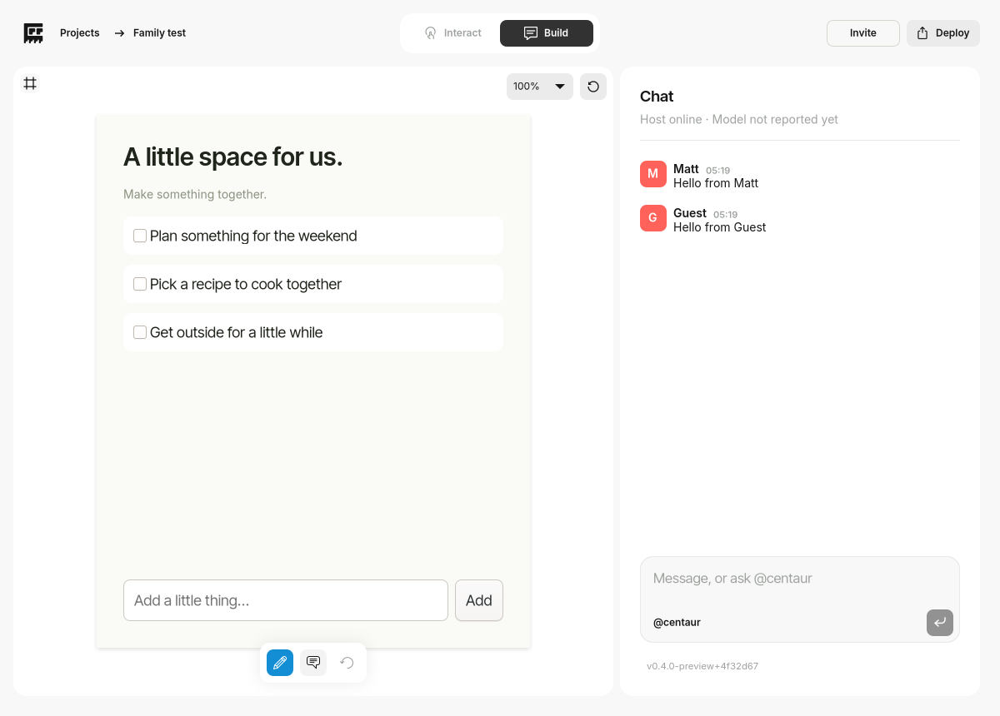
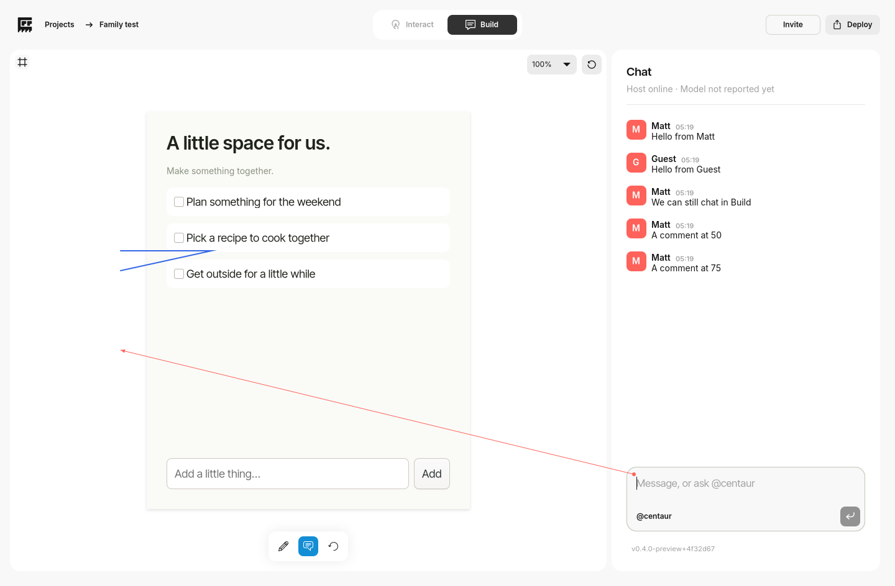

# Canvas toolbar and connected comment pointers

The owner's toolbar is [Figma frame 22:898](https://www.figma.com/design/9RnuP79pD007wjhTdXZ5WW/Centaur?node-id=22-898).
Its white 128×48px surface has 12px corners, 8px padding and gaps, and a subtle
neutral shadow. Draw, Comment and Undo have 32px targets with 16px icon slots.
Selection is `#138ed5` with a white foreground; hover is `#f3f3f3` with the dark
foreground. Labels are supplied as native accessible names and tooltips.
The toolbar stays centred 16px above the canvas bottom in Build mode.

The four original SVG exports are bundled in `assets/figma`: active/normal
Draw, Comment and Undo. Comment's 16×15.2939px artwork is rendered at its native
height within the design's 16px slot, without stretching it. Existing GTK SVG
alpha-mask tinting supplies selection colour. No icon paths are recreated.

## Interaction

1. Click Comment. The arrowhead follows the pointer without a held button.
2. Click a location on the canvas, including inside the embedded application
   or outside its bounds. The head locks to the app-relative location and the
   message field receives keyboard focus. This click does not interact with
   the embedded application.
3. Type the comment. Its thin coral line stays attached to a circular anchor
   at the message field's top-left inset, with a filled triangular head at the
   selected canvas location. The noninteractive overlay spans canvas and chat.
4. Send. The visible arrow clears when the service accepts that message.
   Failed sends preserve the draft and pointer for retry. A later pointer is
   protected by a token, so an earlier message acknowledgement cannot erase it.

Escape or Undo cancels the draft pointer without deleting typed text. Draw,
Interact, project navigation and an app revision change also cancel an obsolete
pointer. Undo otherwise retains its existing author-scoped drawing behaviour.
Updates wait while a pointer draft is active. The pointer itself is local draft
UI; it is not stored as a permanent shared drawing or broadcast while drafting.

## Message and agent context

The optional `comment` object travels with the sent human message:

```json
{"point":{"x":0.1,"y":0.3},"frame":{"x":0.2,"y":0.1,"width":0.6,"height":0.8},"revision":1}
```

It uses the existing annotation frame convention. App-relative coordinates
are `(point.x-frame.x)/frame.width` and `(point.y-frame.y)/frame.height`.
This preserves meaning across independent zoom, pan and window dimensions,
including canvas space outside the application. The tail is derived from the
local composer layout and is never stored as a shared coordinate.

The service validates finite normalized point/frame components, positive frame
dimensions and the current revision before accepting the message. Invalid or
stale targets do not create a conversation entry. The reference is retained
in live/shared messages and the existing conversation journal. Old messages
without the field remain valid; old saved drawing/arrow annotations still load.

An agent-directed message also includes the placed arrowhead and its clipped
shaft in the existing canvas PNG. The compositor/chat area, other windows and
floating controls are excluded. The request's `requestComment` identifies the
specific target associated with `requestText`; the agent prompt explains the
frame convention and revision. There is no extra approval for a compatible
request, and the existing genuine-conflict policy is retained.

## Validation

Python tests cover pointer phases, stopping motion after placement, app-relative
reprojection at all zooms, cancellation and acknowledgement tokens. The native
Wayland product flow checks Figma toolbar geometry/hover/selection, Escape and
Undo cancellation, pointer motion without a held button, second-click focus,
coral head rendering, six zoom levels and outside-app targets. It sends real
messages, checks the reference on the other machine profile and removal after
acknowledgement, then verifies a guest agent request's target and canvas image.
Network regressions check sharing and rejection of stale/invalid locations.
The existing embedding, drawing, collaboration, agent, restart and updater
regressions remain in the same ARM64 publication pipeline.

Hands-on acceptance on the ARM64 NixOS GNOME VM remains in Centaur Install.
No Intel Air testing, NixOS configuration changes or OMP credential changes are
part of this implementation.

## Published ARM64 preview — 11 November 2026

**0.4.0-preview+4f32d67**, immutable source
`4f32d673c246ae9767c881a92df0f016b69ef20b`, store
`/nix/store/sxl9afb5hzzhy1liqhszaa9fsbgml0mn-centaur-gtk4-preview-0.4.0-preview`.
[Product/update CI 42964786419](https://github.com/mattatgit/Centaur/actions/runs/42964786419)
and [standalone embedding CI 42964786349](https://github.com/mattatgit/Centaur/actions/runs/42964786349)
both passed. All 43 Python tests, service/core/network regressions (including
the new shared-comment validation test), native GTK behaviour checks and real
signed updater/restart/recovery passed. Publication verified the complete
531-path signed runtime closure in an empty store with builders disabled.
The release feed was read back and matches the
[retained manifest](evidence/gtk4-comments-4f32d67/manifest.json).

Native evidence artifact `13831250903` contains all six zooms' following/placed
screenshots, toolbar state images and the full product report. Updater artifact
`13831490083` and signed distribution artifact `13831415514` contain their
respective reports. An initial run stopped on a test-only image-variable name
collision; this immutable build corrects that test and passed the complete run.

The [measured toolbar](evidence/gtk4-comments-4f32d67/toolbar-metrics.json) is
128×48px with all three 32px controls, 8px padding/gaps and centred 16px icon
slots. Native screenshots were compared with the Figma reference; the original
SVGs were also rendered locally and confirmed non-empty. The native tests
verify pointer following without a held button, placement/focus, a fixed head
while moving to the composer, send acknowledgement cleanup, peer delivery and
coral rendering at every zoom. The
[recorded agent target](evidence/gtk4-comments-4f32d67/agent-target.json) confirms
the request received its associated reference. The test also checked the
arrowhead's pixels in the attached PNG and exact canvas-only image dimensions.





