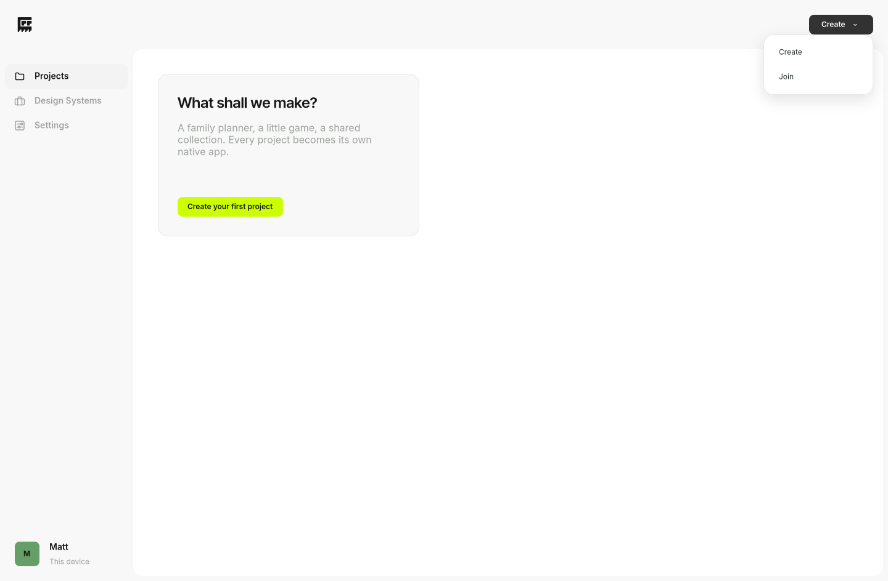
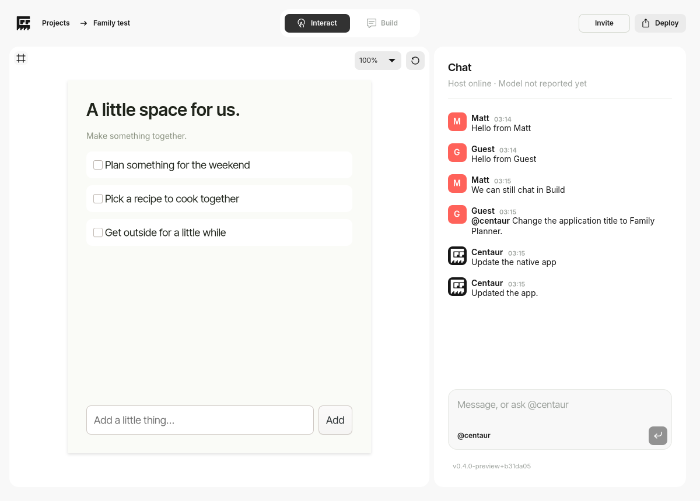
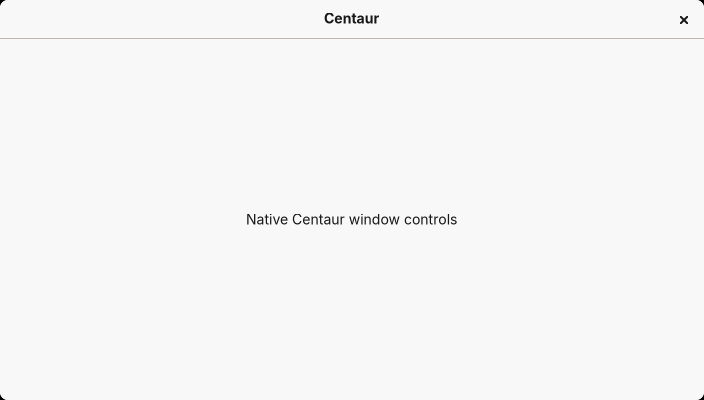
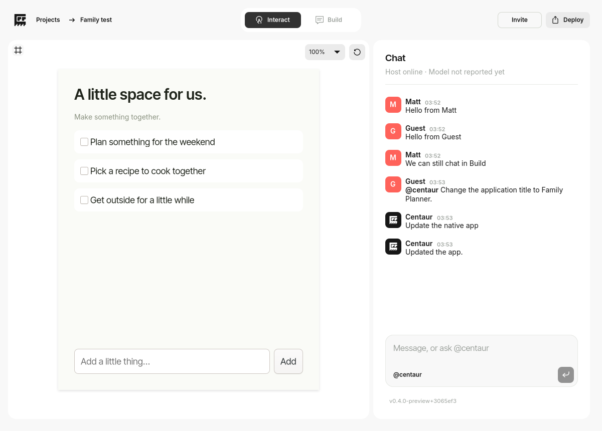

# GTK4 interface reference

The preserved Qt frontend is the visual and interaction reference for the GTK4
development preview. Reference source is `codex/native-prototype` at
`3d24d11e959c1c6ec8c16df5b1c3e4bd7183e450`, particularly `qml/Theme.qml`,
`FlatButton.qml`, `Main.qml`, `SideNavigation.qml`, `ProjectsView.qml`,
`WorkspaceView.qml`, `ChatPanel.qml` and `SettingsView.qml`.

The owner requested that component dimensions and padding also follow an 8px
grid. Fixed geometry is rounded to an 8px step; typography and thin borders keep
their reference sizes. Responsive project-card widths round down to an 8px step
while retaining 32px gutters and a maximum of five columns. Flexible window and
canvas extents can follow the desktop's allocation.

## Layout and controls

| Element | GTK4 reference metric |
| --- | --- |
| Header | 80px high |
| Native GTK titlebar | Centaur-only #F8F8F8 fill in active/backdrop states; default controls, text, borders, shadows and window-state handling retained |
| Centaur UI mark | 24×24px viewport, centred in a 32×32px button; preserves the supplied 30:32 aspect ratio |
| Sidebar | 216px; 72px compact below a 760px window width; hidden in a project |
| Sidebar navigation | 40px high; original 32px SVGs; 8px inset/radius |
| Profile avatar | 40px square, 8px radius |
| Page panel | White, 16px radius |
| Project/settings page padding | 40px, reducing to 24px on small pages |
| Project cards | 256px high; 24px padding; 32px gutters; one to five columns |
| Project badge | 56px square, 16px radius |
| Card options | 32px button; rounded hover/pressed background; Rename/Delete menu |
| Workspace margins | 16px inside the existing 8px page edge |
| Canvas/chat splitter | 8px; chat preferred 432px, minimum 368px, maximum 624px |
| Interact/Build switch | 240 × 48px, centred in the window; two 112 × 32px buttons |
| Standard buttons | 32px high; 8px radius; reference plain/soft/dark/lime/selected tones |
| Build toolbar | 296 × 48px, 16px above the canvas bottom; Draw/Comment/Undo |
| Project action | One 80×32px Create dropdown; 120×64px menu with 24px rows and the original Figma arrow |
| Chat inset/spacing | 24px top/left message inset; 36px from the last body baseline to the next name baseline |
| Chat avatars | 32px square, 8px radius; red human initials, black Centaur tile with the original white mono mark at 15×16px |
| Chat scrollbar | 8px thumb with 8px padding on each side in a separate 24px gutter; text ends 8px before the gutter |
| Composer | 104–184px high; 16px radius; mention control and 32px icon send button |
| Chat footer | Left-aligned 24px-high version/update button, 8px availability badge; status/progress right aligned, 8px gap |

Chat remains available in both modes. The sidebar, project actions and settings
retain the Qt structure. Deployment and design-system import remain placeholders.
Deleting a project still requires explicit confirmation; cancelling is the safe
initial action. Local names, agent naming, grid preferences, invitations and
sharing use the retained controller rather than a second set of UI-only state.

## Typography and assets

Inter is used through 12pt (16px); Inter Tight is used above 12pt. Fonts are the
bundled originals, independent of the desktop's installed fonts.

| Chat element | Family | Size | Weight |
| --- | --- | --- | --- |
| Chat heading | Inter Tight | 14pt | 600 |
| Message body | Inter | 14px / 18px | 400 |
| Composer | Inter Tight | 12.5pt | 400 |
| User/agent names | Inter | 14px | 600 |
| Status/model line | Inter | 10.5pt | 400 |
| Avatar letters | Inter | 9pt | 600 |
| Timestamps | Inter | 11px | 600 |
| Version/update button and footer progress | Inter | 8.5pt | 400 |

The former author/keyboard-hint footer is removed. The version button changes
to **Update app** on hover or keyboard focus, retaining its width. Its 8px
circular availability badge matches the `#ccff00` agent avatar. The footer and
Settings share the same updater; details and acceptance are recorded in
[GTK4_UPDATER.md](GTK4_UPDATER.md).

The main window's `centaur-window` CSS class scopes the native default titlebar
fill override. It sets only background colour/image, keeping the native titlebar,
controls, active/backdrop foreground treatment, border/shadow and maximized,
tiled and fullscreen behaviour. This does not install a custom titlebar or
change GNOME's global theme. Other applications and generated-app processes
retain their own styling. GNOME's actual decorated appearance requires VM review;
the regular headless integration suite deliberately disables decorations.

Published fill adjustment: `4ad8404619110fe170c0ddf9eaafa0e95ee21670`
(`0.4.0-preview+4ad8404`). All 37 checks and [ARM64 product/update run
42753563095](https://github.com/mattatgit/Centaur/actions/runs/42753563095) passed,
along with [standalone embedding run
42753563071](https://github.com/mattatgit/Centaur/actions/runs/42753563071).
Native evidence `13734249042`, updater `13734651883`, signed distribution
`13734836194`. The complete 531-path closure passed signed empty-store download
verification; the release feed advertises this exact source at
`/nix/store/na7m83da1gc9sw7k8rbflp9b16gzfsc1-centaur-gtk4-preview-0.4.0-preview`.
These checks validate the stylesheet and existing app flows; they do not establish
the decorated GNOME titlebar's active/backdrop appearance. That remains a VM check.

Other reference sizes include 14pt/600 project titles, 11pt descriptions, 10pt
card metadata, 14px navigation text, 16px/600 section titles and 12px/600 button
labels. Text sizes do not round to 8px steps.

SVG geometry comes directly from `assets/dialogue`, with the same alpha-mask
colour treatment used by the Qt SVG renderer. The Centaur mark comes from
`packaging/centaur.svg`; the Design Systems suitcase is the approved original
`design-system-empty-suitcase.png` at 176px. Build continues to reuse the approved
Comment SVG; Draw and Undo retain the previously approved temporary glyphs.

## Preserved preview boundary

This is a restoration of Centaur's interface, not a generated-app redesign. The
tested Casilda backend, separate app process, logical app dimensions, five zoom
levels, Fit, centring, panning, clipping and app shadow remain behind the existing
viewport interface. Canvas controls float over the canvas without adding an app
frame. Agent canvas images contain the app and annotations, excluding Centaur's
floating controls and chat.

The VM acceptance issues in `GTK4_MIGRATION.md` remain separate: drawing beyond
app bounds, the unfinished comment-text workflow, generated-app runtime data
persistence and a visible History interface are not resolved by this UI pass.
Neither production Qt replacement nor native macOS embedding is implied.

## Verification

Native ARM64 CI captures the actual GTK frontend on a disposable Wayland desktop,
including empty projects, Design Systems, settings, project dialogs, Interact,
Build, project menus, cancelled deletion and all five grid column counts. It
checks allocated geometry as well as two-profile collaboration, fixture-agent
changes, genuine-conflict agreement, invalid-change rejection, history restore,
preview reopen and clean shutdown. These are automated checks, distinct from
hands-on UTM testing and real OMP/provider requests.

## Navigation and control tidy-up — 11 November 2026

Projects, Design Systems and Settings use their selected sidebar entries as
their page labels; the duplicate titles in the top bar are removed. The top
bar keeps its existing height, actions and workspace breadcrumb.

Invite is an 88×32px secondary button matching Deploy, with the existing 8px
corner radius and hover scaling. A 1px inset `#d3d7ce` stroke leaves its normal
background clear without changing its layout dimensions. Its hover fill is
`#f3f3f3`. Deploy retains the existing filled style and SVG.

The footer version button keeps its label-to-Update-app interaction, fixed
hover width and availability badge. Its 8px horizontal padding and 8px radius
frame a `#ebebeb` hover/focus background. Progress remains on its right.

The product canvas no longer has a Centre button; zoom, Fit, automatic centring
on resize, panning and Restart remain. The separate embedding experiment's
test controls are unchanged.

Published ARM64 build: **0.4.0-preview+4451f19**, source
`4451f19701cf586e0427ce462bc742626075a45a`, store
`/nix/store/q2yc9qwci2bkwcqywivnzmx5dchcfm37-centaur-gtk4-preview-0.4.0-preview`.
[Product/service/updater CI 42927073797](https://github.com/mattatgit/Centaur/actions/runs/42927073797)
and [standalone embedding CI 42927073579](https://github.com/mattatgit/Centaur/actions/runs/42927073579)
passed, including all 37 Python tests, equal allocated button dimensions, and
rendered-pixel checks for the footer hover fill and rounded corners. Project,
Design Systems, Settings, workspace and footer-hover screenshots were inspected.
Native screenshots: artifact `13814801601`; updater screenshots/recovery reports:
`13814577593`; signed distribution: `13814363163`. The complete 531-path signed
closure passed empty-store verification with builders disabled, and the update
feed was read back to confirm this source/path. Hands-on VM review belongs in
Centaur Install.

## Create menu, window corners and chat redline — 11 November 2026

The project header now has one Create menu. Clicking anywhere on it opens
Create and Join; selecting an entry opens the existing corresponding flow.
The chevron is Dialogue's original `assets/profile-arrow.svg`, unmodified and
rotated in GTK CSS. Native popover dismissal and keyboard navigation remain.

Centaur's native CSD window and content clip now have matching 8px bottom
corners. The native headerbar, resize border and window controls remain.
Scoped CSS explicitly returns the window and content to square corners when
maximised, tiled (including directional tiled classes) or fullscreen. No GNOME
theme/configuration is changed. The native decorated-window fixture checks the
actual bottom-corner pixels with an otherwise opaque content child.

The chat redline's explicit metrics supersede the older Qt reference for
message rows: 32px avatar, 8px avatar-to-text gap, names and body in 14px Inter,
18px body line spacing, and adjacent 11px semibold timestamps. Mentions use the
specified 14px semibold emphasis; other body text stays regular. The first body
baseline aligns with the avatar's bottom edge. Inter's name/body baseline
metrics require a 17px box gap to obtain the requested 36px between a comment's
last baseline and the following name baseline. This metric-derived gap is
intentional. The native report records the actual baselines, rather than
assuming a widget gap equals a text-baseline gap.

The scrollbar uses GTK's native scrollbar and scroll adjustment in a separate
24px gutter at the panel edge. Its thumb is 8px wide, with 8px on each side;
message text ends another 8px before that gutter. Message scrolling waits for
the layout frame before following the latest message, avoiding a stale scroll
range that can hide the last line. Composer/footer geometry remains separate.

Published ARM64 build: **0.4.0-preview+b31da05**, source
`b31da05dcdef5686323ad61bf7ed0f8f234b9c81`, store
`/nix/store/8w3w48ac94k32f929d69y1klrp7w95hc-centaur-gtk4-preview-0.4.0-preview`.
[Main ARM64 product/update CI 42951176684](https://github.com/mattatgit/Centaur/actions/runs/42951176684)
passed all 39 Python checks, native embedding, core/network services,
two-profile collaboration, canvas regressions, exact chat geometry, native
corner pixels, live signed-transfer progress, updater activation/recovery and
data-preservation checks. Signed publication verified all 531 runtime paths in
an empty store with builders disabled. The public feed was read back and
matches the [retained manifest](evidence/gtk4-chat-b31da05/manifest.json).
Native artifact: `13824499836`; updater: `13825167716`; signed distribution:
`13825620502`.

The [measured chat baselines](evidence/gtk4-chat-b31da05/chat-metrics.json) are
exactly 36px apart, with the first body baseline 0.093px below the avatar's
32px bottom (font rasterisation precision). The scrollbar gutter is exactly
24px. A short chat retains the gutter without painting a full-height thumb.
The original native close action, glyph and titlebar allocation were unchanged;
[window measurements](evidence/gtk4-chat-b31da05/window-metrics.json) include the
bottom-corner pixel checks and the existing native window-management coverage.

The separate [standalone workflow 42951176668](https://github.com/mattatgit/Centaur/actions/runs/42951176668)
failed before launching the app: the disposable Sway compositor did not answer
an initial IPC readiness query. Its same embedding checks passed inside the
main product run. A standalone rerun could not be requested because the GitHub
connector lacks Actions write permission; the browser session was signed out.
Do not describe both workflows as passing. Hands-on GNOME VM review and the
actual VM download-counter diagnosis remain in Centaur Install.

Selected native screenshots were inspected and retained for review:

## Figma component refinement — 11 November 2026

Reference: [Create + Join, frame 20:802](https://www.figma.com/design/9RnuP79pD007wjhTdXZ5WW/Centaur?node-id=20-802).
The native Create button is 80×32px with an 8px radius, `#171717` background,
12px semibold Inter Tight caption and the original 24×24px Figma arrow asset.
The frame's actual child positions are preserved: a 39×16px caption at (12,8)
and a 24×24px arrow viewport at (51,4). Those positions leave 5px at the right
of the 80px frame, despite the generated reference's 8px padding property.
The rendered geometry is the reference here. The button stays dark while open.

The right-aligned popup begins at the button's bottom edge. Its white 120×64px
surface has an 8px radius, 8px padding and the reference's subtle neutral
shadow. The two 104×24px rows have no vertical gap, 8px horizontal text padding,
12px regular Inter Tight captions **Create a project** and **Join a project**,
and an 8px-radius `#f8f8f8` hover/focus fill. The existing native popover,
keyboard dismissal and create/join callbacks remain.

The supplied 30:32 Centaur mono artwork now renders in a centred 16×16px
viewport, producing the requested 15×16px silhouette inside the unchanged
32×32px black chat avatar with 8px corners. The SVG paths and aspect ratio are
unchanged. The sidebar and workspace brand marks keep their existing sizes.

The Figma arrow is bundled under `assets/figma` and packaged at its original
24×24px dimensions. No temporary Figma asset URL is used at runtime. Its local
SVG was rendered and checked for visible, non-empty geometry. Native tests
measure the button, caption, arrow, popup rows, text inset and avatar centring,
and sample the real hover fill/corners. Other project-card menus keep their
existing metrics.

Published ARM64 build: **0.4.0-preview+3065ef3**, source
`3065ef3a45a9e92d1edde1078d8ef9022afdb95f`, store
`/nix/store/xgia8d4s33hraj56q6pjfz5gf3ryzxfi-centaur-gtk4-preview-0.4.0-preview`.
[Product/update CI 42955017529](https://github.com/mattatgit/Centaur/actions/runs/42955017529)
and [standalone embedding CI 42955017502](https://github.com/mattatgit/Centaur/actions/runs/42955017502)
both passed, including all 39 Python checks, native measured Figma geometry,
hover pixel/corner checks, centred avatar geometry, existing application
regressions and real signed update/restart/recovery. The complete 531-path
signed closure passed empty-store verification with builders disabled. The
feed was read back and matches the [retained manifest](evidence/gtk4-figma-3065ef3/manifest.json).
Artifacts: native `13826458394`, updater `13825929454`, signed distribution
`13827120850`.

The [menu measurements](evidence/gtk4-figma-3065ef3/create-metrics.json) match
Figma's actual frame/child positions and its 8px menu/text insets.
The [avatar measurements](evidence/gtk4-figma-3065ef3/avatar-metrics.json)
confirm the 16×16px viewport is inset 8px on all sides of the 32px box. The
unchanged 30×32px source yields the requested 15×16px silhouette. The supplied
SVGs are non-empty, locally packaged, in their correct slots and visibly
rendered in the inspected screenshots. Hands-on VM review is in Centaur Install.

