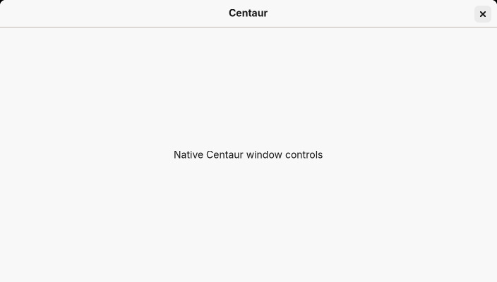
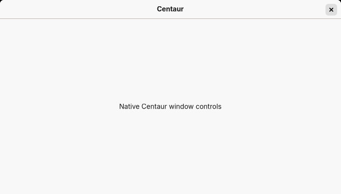

# GTK4 native close control

The 10 November 2026 refinement uses scoped CSS in `gtk4/embedding/shell.css`.
Centaur still lets `GtkWindow` create its normal native headerbar. The close
button keeps GTK's `window.close` action, symbolic X, accessible identity and
focus policy. No custom titlebar or window-control icon is introduced.

The native theme paints its circular highlight on the button's child `image`.
That background is replaced with a 24×24px rounded square (6px radius), inset
8px from the visible top and right edges. Hover is `#ebebeb`; pressed is
`#dedede`. The surrounding 32×32px transparent button supplies the larger hit
target. Its invisible corners stay square because GTK includes CSS corner
rounding in pointer hit testing. The old parent and image backgrounds are both
cleared, so the original circle cannot show underneath.

The small internal margin/translation compensates for the native theme's
30px image, retaining the existing titlebar allocation and content position.
The titlebar remains `#f8f8f8`. Window corner styling, native state classes,
drag handle, resize handling and close action are unchanged. All new selectors
start with `window.centaur-window > headerbar.titlebar`; other applications
cannot receive this provider or these selectors.

## Regression evidence

`window_controls_check.py` runs inside the existing disposable ARM64 Wayland
integration display. It measures the real GTK widgets before/after adding
`centaur-window`, checks dimensions/insets and the original action/icon, checks
rendered hover pixels for the removed circle, and clicks eight outer points of
the full target. It records normal, hover, pressed, disabled, inactive, tiled
and fullscreen images plus a synthetic focus-visible image. The native close
button's normal focus policy is preserved; the focus image does not imply it
has been added to the Tab chain.

Sway normally offers server decorations. Only the test process filters its
optional decoration protocols before GTK initialises, so GTK creates its own
default decorations as on GNOME. Production has no such environment override.
The test also exercises native titlebar dragging, compositor resizing, tiling,
fullscreen/restore and final native close. A second unscoped native window
checks that its original control dimensions are retained.

These CI tests supplement hands-on GNOME acceptance. The ARM64 NixOS UTM VM
must still check visual alignment at its actual display scale, inactive/focus
appearance, the full pointer target, maximise/restore, native pointer resizing,
dragging and tiled states. No claim of hands-on GNOME acceptance is made by
the Sway test. Installation and that checklist belong in Centaur Install.

## Published ARM64 preview — 10 November 2026

Immutable source: `af3492ec23ef48f8d87aa9b4c2a87e6911dbaacc`.
Version: **Centaur GTK4 0.4.0-preview+af3492e**.
Store: `/nix/store/ks504kir4x3wn5dssxq1by20h2b65ky7-centaur-gtk4-preview-0.4.0-preview`.

[Product, service, updater and signed-publication CI 42758277252](https://github.com/mattatgit/Centaur/actions/runs/42758277252)
and [standalone embedding CI 42758277357](https://github.com/mattatgit/Centaur/actions/runs/42758277357)
passed. All 37 Python tests passed. The existing publisher verified the complete
531-path signed closure in an empty store with builders disabled. The public
`gtk4-preview` feed was read back after publication and identifies this exact
source and store path. The real updater activation/recovery regressions passed,
including preservation checks for the separate Qt installation/data.

[Native evidence artifact 13736507645](https://github.com/mattatgit/Centaur/actions/runs/42758277252/artifacts/13736507645),
[updater artifact 13737150344](https://github.com/mattatgit/Centaur/actions/runs/42758277252/artifacts/13737150344),
and [signed distribution artifact 13736970685](https://github.com/mattatgit/Centaur/actions/runs/42758277252/artifacts/13736970685)
contain the full reports. Selected native screenshots and the exact widget
measurements are retained here so the visual evidence survives artifact expiry.

The [measured bounds](evidence/gtk4-close-af3492e/metrics.json) show the titlebar
remaining 704×39px and content starting at y=39 before/after styling. The new
32×32px button starts at (668,4); its 24×24px image starts at (672,8), giving
exactly 8px top/right insets. All eight outer target points activated the native
close action. The native symbolic icon and focus policy were unchanged.

Hover (inspected at native resolution):

Pressed:

Normal, disabled, inactive and tiled screenshots were also inspected. GNOME
hands-on visual acceptance remains pending; CI uses Sway, not the owner's VM.
